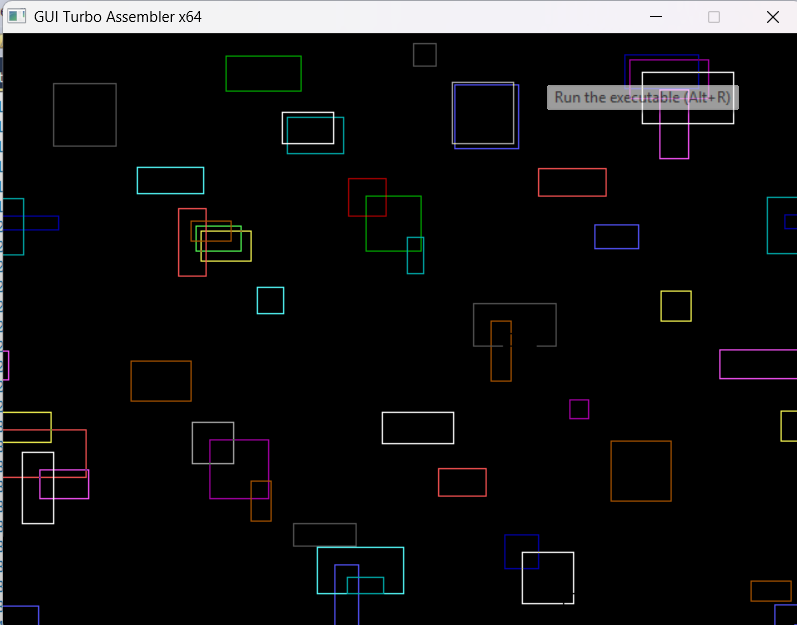
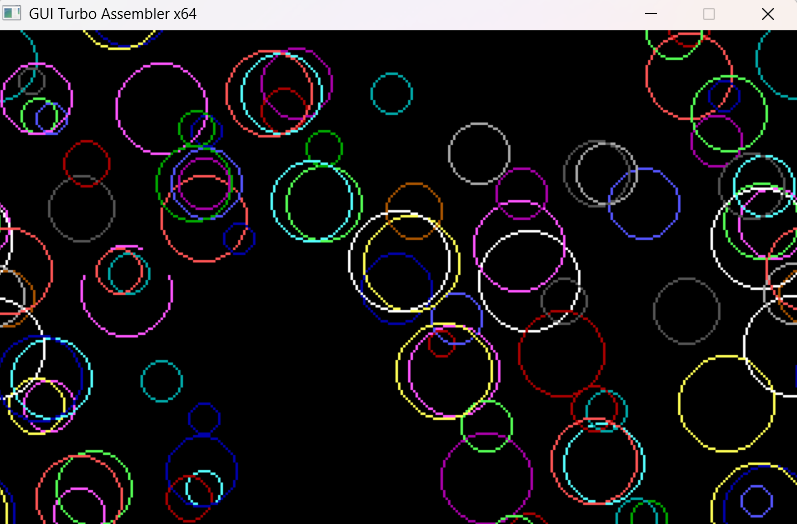
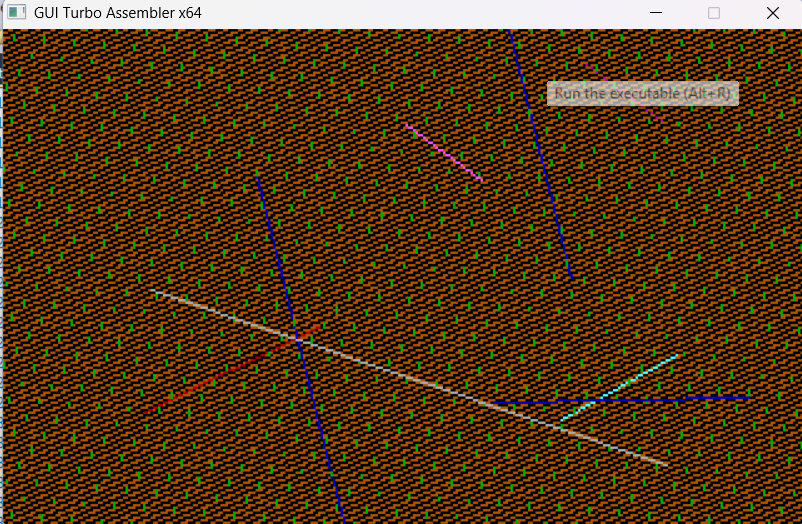

# Proyecto Gráfico en Lenguaje Ensamblador

Este proyecto permite dibujar **rectángulos**, **círculos** y **líneas** de forma **aleatoria** utilizando lenguaje ensamblador. Fue desarrollado como parte de una práctica de programación de bajo nivel, haciendo uso de interrupciones y funciones gráficas.

##  Tecnologías utilizadas

- Lenguaje Ensamblador (ASM)
- BIOS/INT 10h (modo de video)
- Ensamblador TASM 
- Emulador GuiTurboAssembler

##  Funcionalidades

- Dibujo aleatorio de:
  - Rectángulos
  - Círculos
  - Líneas
- Selección del tipo de figura a dibujar mediante menú
- Uso de coordenadas, colores y tamanios generadas aleatoriamente dentro de la pantalla

##  Cómo compilar y ejecutar

1. Abre GUI Turbo Assembler.
2. Copia los archivos al directorio de trabajo.
3. Ejecuta el archivo que desees:

##  Capturas de pantalla

## Detalles Técnicos del Proyecto en Ensamblador

| FUNCIONALIDAD (A) | ASPECTO TÉCNICO (B) | DESCRIPCIÓN (C) |
|-------------------|---------------------|------------------|
| **1. Creación del Menú** | Teclas utilizadas: • '1' - Rectángulo • '2' - Círculo • '3' - Línea • '4' - Salida  INTERRUPCIONES: • INT 10h • INT 21h • INT 16h | Se usó una estructura de menú con mensajes impresos mediante `INT 21h` y detección de teclas con `INT 16h`. El programa presenta un menú con opciones numeradas que dirigen al usuario a dibujar figuras o salir. Se emplearon subrutinas para mejorar la legibilidad, y se retorna al menú desde cualquier opción presionando nuevamente su tecla correspondiente. |
| **2. Rectángulos** | Tecla asociada: `'1'`  INTERRUPCIONES: • INT 10h • INT 21h • Semilla aleatoria • Subrutina punto | Se generan posiciones (x, y), ancho, alto y color de forma aleatoria. Luego se trazan los lados del rectángulo mediante 4 subrutinas: `RRIG`, `RLEFT`, `RUP`, `RDOWN`, cada una encargada de trazar un lado. Se pueden dibujar múltiples rectángulos hasta presionar `'2'` para regresar al menú. |
| **3. Círculos** | Tecla asociada: `'2'`  INTERRUPCIONES: • INT 10h • INT 21h • Semilla aleatoria • Subrutina punto | Se genera una posición aleatoria para el centro del círculo y un radio dentro de un rango permitido. Se utiliza el **algoritmo de punto medio del círculo** para dibujarlo usando simetría y eficiencia. Se pueden dibujar varios círculos hasta presionar `'2'` para volver al menú. |
| **4. Líneas** | Tecla asociada: `'3'`  INTERRUPCIONES: • INT 10h • INT 21h • Semilla aleatoria • Subrutina punto | Se generan dos pares de coordenadas aleatorias (x1, y1) y (x2, y2). El trazado se realiza seleccionando uno de los 4 tipos de lineas disponibles y graficando punto a punto la longitud total de la linea. Se pueden trazar varias líneas hasta presionar `'3'` para volver al menú. |
| **5. Salida** | Tecla asociada: `'4'`  INTERRUPCIONES: • INT 21h (servicio 4C00h) | Al presionar la tecla `'4'`, se ejecuta la salida limpia del programa utilizando la interrupción `INT 21h`, función `4C00h`, que cierra el programa y retorna el control al DOSBox o sistema operativo. |

